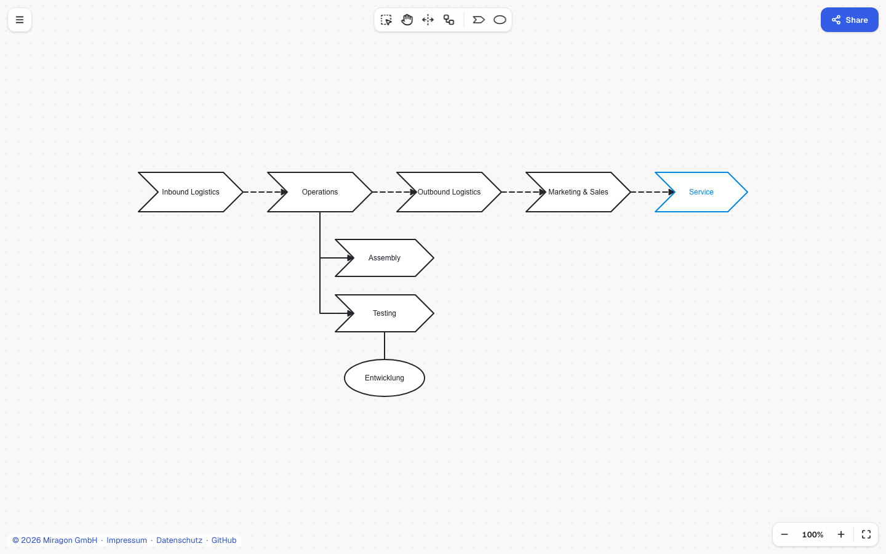

# Value Chain Modeler

A web-based editor for value chain diagrams
([Wertschöpfungskettendiagramme](https://de.wikipedia.org/wiki/Wertsch%C3%B6pfungskettendiagramm),
ARIS-style value-added chain diagrams), built on
[diagram-js](https://github.com/bpmn-io/diagram-js) and the Miragon design system. In VS Code it
runs inside the shared Miragon modeler chrome
([`@miragon/modeler-shell`](https://www.npmjs.com/package/@miragon/modeler-shell)), and the
renderer implements the collaborative-modeler contract
([`@miragon/modeler-api`](https://www.npmjs.com/package/@miragon/modeler-api)) for
collaborative hosts.



## Notation

- **Step** ("Wertschöpfungskette") — a right-pointing chevron / block arrow.
- **Organizational unit** ("Organisationseinheit") — an ellipse, assigned to a step.
- **is predecessor of** — sequence relation, dashed edge with an arrowhead.
- **is process-oriented superior** — hierarchy relation, solid edge with an arrowhead.
  Routing follows the sub-steps' arrangement: a horizontal row under the parent gets
  vertical drops, a vertical column gets the ARIS rake entering from the left.
- **assignment** — plain solid edge between an organizational unit and a step.

## Packages (npm workspaces)

| Package                             | Purpose                                                          | DOM |
| ----------------------------------- | ---------------------------------------------------------------- | --- |
| `@miragon/value-chain-schema-model` | Metamodel, Zod validation, migrations, stable JSON serialization | no  |
| `@miragon/value-chain-renderer`     | diagram-js viewer/modeler, chevron renderer, import/export, CSS  | yes |
| `apps/webapp`                       | Vite editor app                                                  | yes |
| `apps/vscode`                       | VS Code extension: custom editor for `*.vc` / `*.vc.json`        | yes |
| `e2e`                               | Playwright end-to-end tests: the webapp and the VS Code webview  | yes |

## Quick start

```sh
npm install
npm run dev:webapp        # editor at http://localhost:5181
```

## Usage (library)

```ts
import { Modeler } from '@miragon/value-chain-renderer';
import '@miragon/value-chain-renderer/assets/value-chain.css';
import { createEmptyDocument } from '@miragon/value-chain-schema-model';

const modeler = new Modeler({ container: document.querySelector('#canvas') });
modeler.importDocument(createEmptyDocument('My value chain'));

const document = modeler.exportDocument(); // JSON document
const { svg } = modeler.saveSVG(); // standalone SVG
```

`Viewer` (read-only) and `NavigatedViewer` (read-only + zoom/pan) are exported as well;
`additionalModules` extends the DI container like in bpmn-js. For collaborative hosts,
`createCollaborativeModeler()` and `createCollaborativeViewer()` wrap them in the
`@miragon/modeler-api` contract (`importText`/`exportText` on the canonical JSON, silent imports,
change events, view state, stable element ids); see the
[renderer README](packages/renderer/README.md).

## Editor features

Palette (lasso, hand, space, connect tools + step/org-unit creation, also by Enter or Space),
context pad (append successor, append sub-step, append org unit, typed connect, switch relation
type, color, delete), direct label editing (double-click / E), undo/redo, copy/paste, select all,
snapping + grid snapping, bendpoints, keyboard shortcuts (L/H/S/C/E, arrows, Cmd/Ctrl+A/Z/Y/C/V),
SVG export (and PNG in VS Code), JSON open/save, localStorage autosave. Documents keep keys of
other tools through every edit.

## Commands

- `npm run build` — build the library packages · `npm run build:webapp` · `npm run build:vscode`
- `npm run dev:webapp` — editor at http://localhost:5181 · `npm run dev:vscode` — extension watch
- `npm test` — unit tests · `npm run test:browser` — Chromium integration tests and the
  `@miragon/modeler-api` conformance kit · `npm run test:e2e` — Playwright end-to-end, the
  `@miragon/modeler-shell` conformance kit included
- `npm run lint` — ESLint + typecheck · `npm run depcruise` — module-graph rules
- `npm run format` — Prettier

Requirements: Node ≥ 22.13, npm. Contributor guide: [CONTRIBUTING.md](CONTRIBUTING.md).
